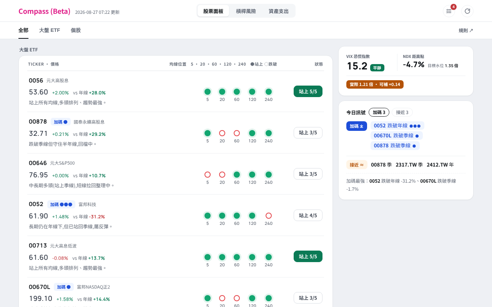

# Compass (Beta)

A personal investing dashboard in one HTML file. Open it and you see four things: which of your holdings just dropped below a moving average, how much you borrowed and how far the market can fall before the broker sells you out, where your money actually sits, and what you spent this month.

**Live demo:** https://chouhsuan1202.github.io/market-compass/

This is the public copy. It is called **Compass (Beta)** and the title is pink, so it is easy to tell apart from a private copy. Every number in it is made up: the holdings, the share counts, the cash, the mortgage, the transactions. No real account, no real position, no real trade.

The sample data is a Taiwan office worker in New Taiwan dollars: a salary, a mortgage, a few dividend ETFs and eight local stocks. Swap in your own numbers and currency and it follows.



## Run it

No build step, no account, no database. The page does need to be served over http, because browsers block a page opened straight from disk (`file://`) from reading `data.json`. Double clicking `index.html` gives you a page that says it cannot read the data.

The quickest way, with [Node.js](https://nodejs.org) 22 or newer installed:

```
npm start
```

Then open http://localhost:8000/ . Any static file server works too, for example `python3 -m http.server 8000` in this folder.

On a phone, open the live demo and add it to the home screen. It then runs full screen like an app, and still opens offline with the last data it saw.

## The tabs

| Tab | The question it answers |
|---|---|
| Stocks | Which tickers just fell below the 5, 20, 60, 120 or 240 day average, so I can add |
| Leverage | How much did I borrow, and how far can the market drop before I get liquidated |
| Assets | How much do I have, split into ETFs, single stocks and everything else |
| Spending | Where did the money go this month, and did I go over my baseline |

On a wide screen Assets and Spending share one page, with Spending shown first.

## Use your own numbers

Edit these files and the screen follows. Nothing else to change.

| File | What goes in it |
|---|---|
| `asset-portfolio.json` | Which tickers you hold in which account, and how many shares |
| `asset-balances.json` | Bank cash, property, mortgage. Anything without a market price |
| `asset-milestones.json` | Historical net worth points, for the long term chart |
| `leverage-data.js` | A snapshot of your broker account: equity, loan, maintenance margin |
| `expense-data.js` | Every transaction for the month |
| `watchlist.json` | Which tickers to track |

`data.json` holds prices and moving averages. Refresh it daily with your own script and a quote API. This repo ships a trimmed sample so the charts have something to draw.

`asset-data.js` is computed. Do not hand edit it.

## Test it

```
npm install
npx playwright install chromium   # first time only, downloads the test browser
npm test
```

`npm test` runs two sets:

| Command | What it checks | Time |
|---|---|---|
| `npm run test:unit` | The math in `js/core.js`: moving average signals, the leverage ladder, borrowing ratio, distance to margin call, average buy price, spending totals | about 1 second |
| `npm run test:e2e` | Opens the real page in Chromium at phone and desktop width: smoke test of every tab, broken or missing data, slow network, HTML injection, WCAG 2.1 AA with axe, keyboard use, extreme numbers in charts | a few minutes |

The same tests run on GitHub for every pull request and every push to `main` (see `.github/workflows/test.yml`).

## Where things live

| Path | What it is |
|---|---|
| `index.html` | The page skeleton: header, tab bar, empty panels, dialogs |
| `css/app.css` | All styles. `css/demo.css` holds the few overrides for this public copy (pink title) |
| `js/core.js` | Pure calculations with no screen code. This is what the unit tests cover |
| `js/stocks.js` | Stocks tab, signal cards, rules dialog |
| `js/risk.js` | Leverage tab |
| `js/perf.js` | Return vs S&P 500 chart inside the Leverage tab |
| `js/asset.js` | Assets tab |
| `js/expense.js` | Spending tab |
| `js/chart.js` | Price chart dialog |
| `js/todo.js` | To-Do dialog |
| `js/app.js` | Switching tabs, clicks and keyboard, loading the data. Loads last |
| `sw.js` | Service worker, keeps the last copy for offline use |
| `docs/` | The copy GitHub Pages serves. After changing anything above, run `npm run sync` to copy it over |

The scripts are plain `<script>` files, not modules, and they load in the order listed in `index.html`. Keep that order when you add one.

## Ideas behind it

**It describes, it does not predict.** The dashboard never says "buy now". It says "this fell below the 60 day line". What you do about that is your call.

**Two separate risk lines.** Liquidation risk only counts collateral inside the broker account, because money sitting elsewhere takes days to move and will not save you. The total borrowing cap is measured against everything you own.

**Phone and desktop are two different layouts,** not one shrunk down. On a phone you want fewer things on screen, not the same things smaller.

## License

MIT. Fork it, change it, make it yours.
